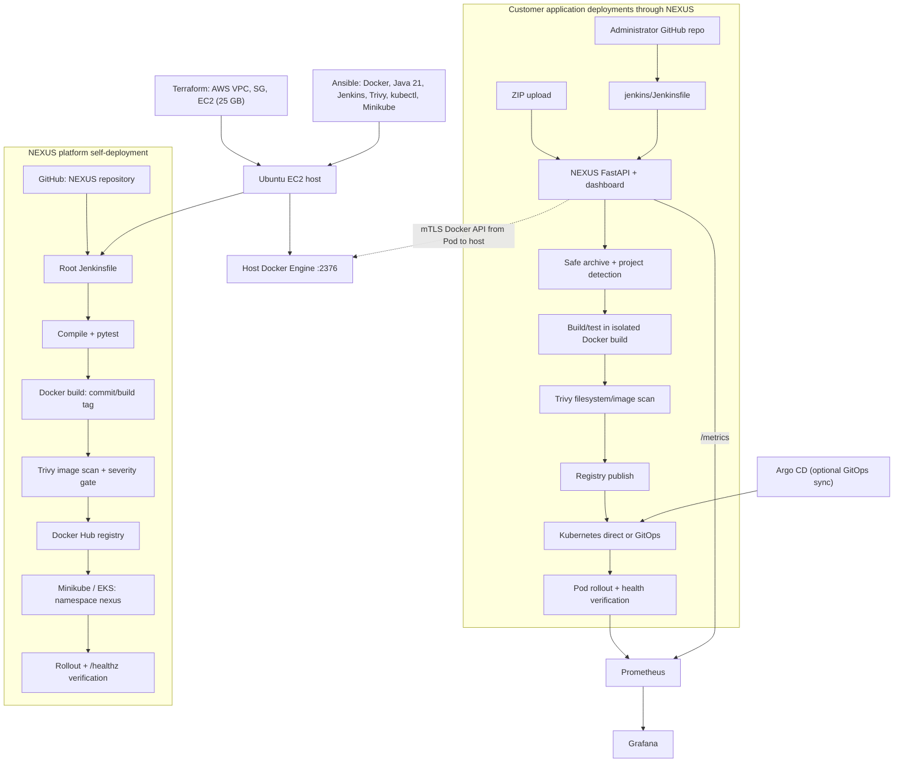
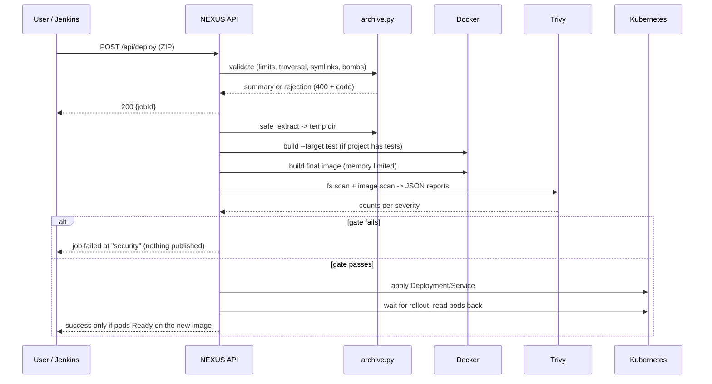
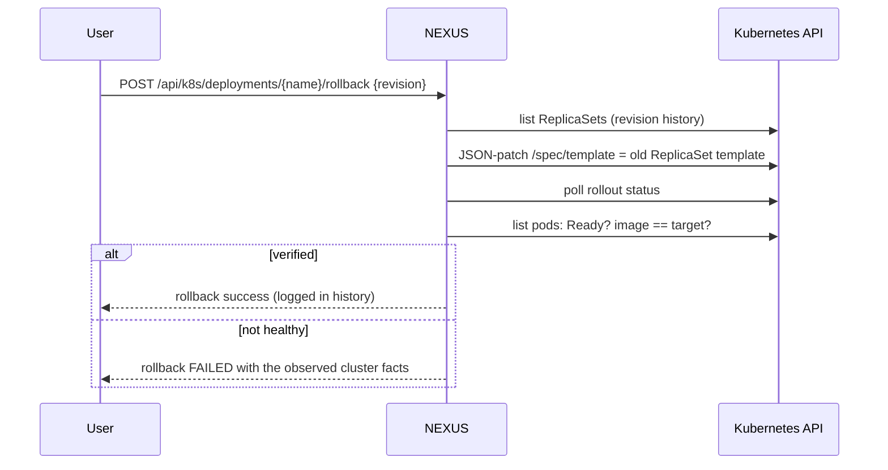

# NEXUS architecture

## 1. End-to-end flow

The repository contains **two intentionally separate CI/CD paths**: the root Jenkinsfile deploys NEXUS itself, while `jenkins/Jenkinsfile` submits customer application source to the shared NEXUS release pipeline.

## 2. Who does what

| Component | Responsibility | Not its job |
|---|---|---|
| **NEXUS** | Accepts ZIPs, runs the single pipeline, stores history, shows status, performs rollback | Holding end-user GitHub logins |
| **Jenkins** | Root `Jenkinsfile` tests/builds/scans/pushes/deploys NEXUS; `jenkins/Jenkinsfile` checks out customer code and submits it to the shared NEXUS pipeline | Replacing NEXUS's shared release logic |
| **Docker** | Jenkins builds the NEXUS platform image; NEXUS uses a host Docker Engine via an optional mutual-TLS endpoint for isolated customer builds | Exposing an unauthenticated Docker socket/API |
| **Trivy** | Scans the source tree and the built image; NEXUS applies the gate | Deciding policy (the threshold is NEXUS config) |
| **Kubernetes** | Runs the app, rolls out and rolls back | |
| **Argo CD** (optional) | Keeps the cluster equal to the manifests in Git | Building images |
| **Prometheus / Grafana** | Collect and display metrics | Making deployment decisions |
| **Terraform** | Creates the AWS network + EC2 server (run once, from your laptop) | Installing software |
| **Ansible** | Installs/configures software on that server | Creating AWS resources |

## 3. Deploy modes (chosen automatically at release time)

| Mode | When | What happens |
|---|---|---|
| `gitops` | `GIT_REPO_URL` + `ARGOCD_URL` + registry set | Push image, commit manifests to Git, wait for Argo CD Synced + Healthy |
| `direct` | Registry (or `K8S_IMAGE_SOURCE=minikube`) set **and** the cluster API answers | Push/load image, create-or-patch Deployment + Service, wait for rollout, verify pods |
| `local` | Nothing else configured | Run the image as a Docker container, health-check it from inside |

## 4. Release sequence

## 5. Rollback sequence

